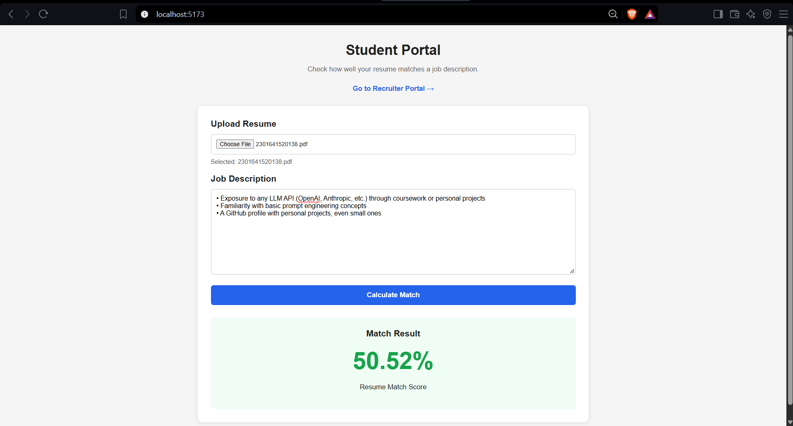
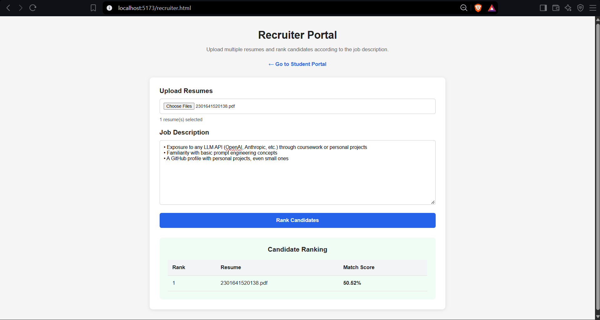
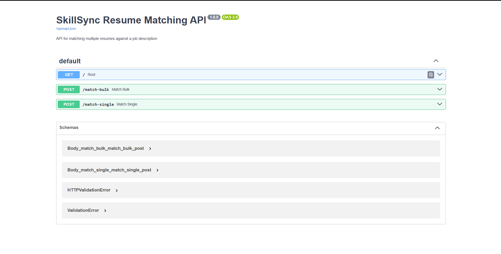

SkillSync

SkillSync is a resume and job description matching system that helps students understand how well their resume matches a job role and helps recruiters compare multiple candidates.

🔗 Project Links

GitHub Repository: https://github.com/PranikaKDixit/Skill-Sync

Student Portal: http://localhost:5173

Recruiter Portal: http://localhost:5173/recruiter.html

API Documentation: http://localhost:8000/docs

The local application links are available when the project is running.

📌 Overview

SkillSync analyzes a resume against a given job description and generates a match percentage along with matched and missing skills.

The project provides two main portals:

Student Portal – Upload a resume and check its match with a job description.

Recruiter Portal – Upload multiple resumes and compare candidates based on their match scores.

✨ Features

PDF resume upload

Job description based matching

Resume match percentage

Matched skills

Missing skills

Multiple resume comparison

Candidate ranking

FastAPI Swagger API documentation

Dockerized application

⚙️ How It Works

Resume + Job Description
          ↓
    PDF Text Extraction
          ↓
     Matching Engine
          ↓
 Match Score + Skills
          ↓
      Result Display

For recruiters, multiple resumes are processed and compared with the selected job description.

🛠️ Tech Stack

Category

Technology

Frontend

HTML, CSS, JavaScript

Backend

Python, FastAPI

Matching

Keyword, Skill & TF-IDF based matching

PDF Processing

PDF Parser / Poppler

Web Server

Nginx

Containerization

Docker & Docker Compose

## 📸 Screenshots

### Student Portal

The Student Portal allows students to upload their resume, enter a job description, and view the matching result.



### Recruiter Portal

The Recruiter Portal allows recruiters to upload multiple resumes and compare candidates based on their matching scores.



### API Documentation

SkillSync provides interactive API documentation through FastAPI Swagger UI.




🚀 Getting Started

Prerequisites

Make sure the following are installed:

Docker Desktop

Git

Clone the Repository

git clone https://github.com/PranikaKDixit/Skill-Sync.git

Navigate to the Project

cd Skill-Sync

Start the Application

docker compose up --build

🌐 Application URLs

Once the application is running:

Application

URL

Student Portal

http://localhost:5173

Recruiter Portal

http://localhost:5173/recruiter.html

Backend API

http://localhost:8000

Swagger API Docs

http://localhost:8000/docs

🛑 Stop the Application

To stop the application, run:

docker compose down

## 📂 Project Structure

```text
Skill-Sync/
│
├── .github/
│   └── workflows/              # GitHub configuration/workflows
│
├── .trunk/                     # Trunk configuration
│
├── backend/                    # FastAPI backend
│   ├── Dockerfile
│   ├── main.py
│   ├── requirements.txt
│   ├── __init__.py
│   └── .gitkeep
│
├── frontend/                   # Student & recruiter portals
│   ├── index.html
│   ├── recruiter.html
│   ├── script.js
│   └── style.css
│
├── ml/                         # Resume-job matching logic
│
├── pdf_parsing/                # PDF resume processing
│
├── data/                       # Project data
│   ├── job_descriptions/
│   └── resumes/
│
├── docs/
│   └── screenshots/            # Project screenshots
│       ├── student-portal.png
│       ├── recruiter-portal.png
│       └── swagger-api.png
│
├── docker-compose.yml          # Docker services configuration
├── index.html                  # Root student portal
├── recruiter.html              # Root recruiter portal
├── script.js                   # Root frontend script
├── style.css                   # Root frontend styles
└── README.md                   # Project documentation

👥 Contributors

Pranika Dixit

Navagya Singh

Preetika Gupta

Pragati Patel

kashish Nigam

Noor Bano

📄 License

This project is developed for academic purposes.
